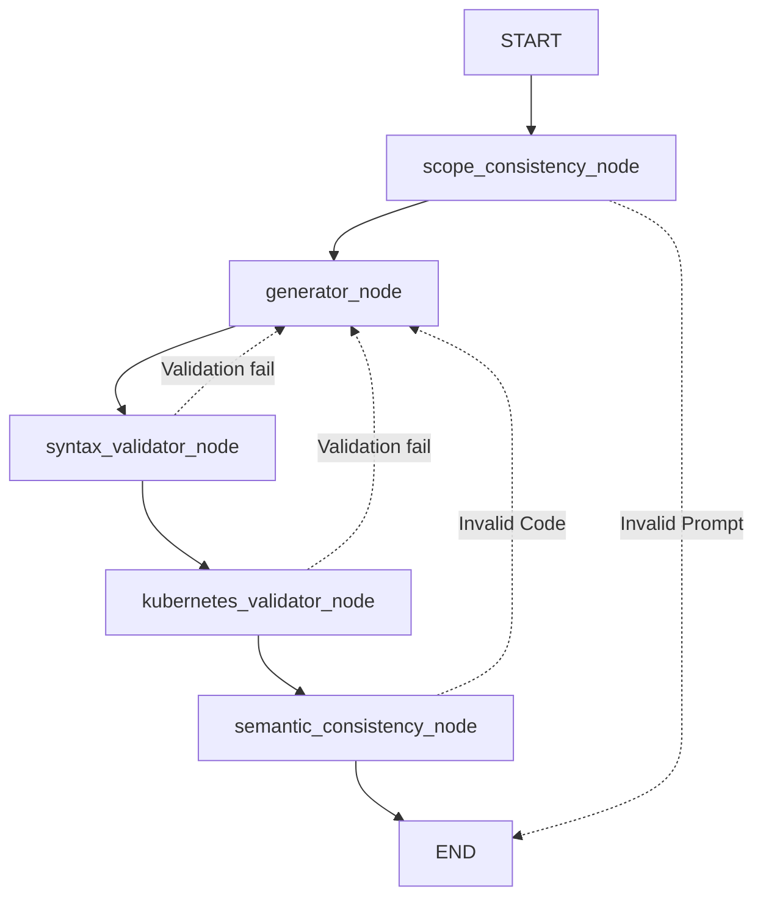

# agent4net-intent

Companion code for the paper **"Intent-Driven Kubernetes Manifest Generation through Agentic AI and Iterative Validation"** (E. Bariselli, S. Braghin, A. Sacco, L. Nedoshivina, G. Marchetto).

The repository contains a LangGraph-based agent that translates natural-language intents into Kubernetes manifests, a three-stage validation pipeline with a bounded autonomous repair loop, the benchmark scenarios used in the evaluation, and the scripts used to run the experiments and compute the metrics.

The benchmark dataset of 600 paraphrased intents is publicly available on [Hugging Face](https://huggingface.co/datasets/elisa0205/kubernetes-configurations) ([DOI](https://doi.org/10.57967/hf/10308)).

## Goal

Given a natural-language task, the agent:
1. Checks the scope of the prompt, blocking malicious or unrelated requests;
2. Generates the Kubernetes YAML manifest;
3. Validates syntax with `yamllint`;
4. Validates deployability by applying the manifest to a fresh, ephemeral [Kind](https://kind.sigs.k8s.io/) cluster (created and destroyed for each attempt);
5. Checks that the generated manifest satisfies the user's request (LLM-based semantic check);
6. Regenerates the YAML using the validator feedback when errors are found (bounded to 7 attempts).

## Repository structure

### Root

- `pyproject.toml`: project metadata and Python dependencies.
- `yamllint_config.yaml`: `yamllint` configuration used by the syntax validator.
- `prompts.yaml`: canonical prompts for the agent nodes, with model-specific variants.
- `.env.example`: template for the provider credentials read by the agent.

### src/

Application source code of the agent:
- `agent.py`: agent state definition, LangGraph nodes, and loop logic.
- `main.py`: FastAPI application exposing the agent through a `POST /manifest` endpoint.
- `utils/`: helper functions and the ephemeral Kind cluster testbed.

### test_and_metrics/

Scripts used to run the experiments and evaluate the agent:
- `manifest_generator.py`: runs the agent over a CSV of intents via the API (see Usage).
- `intent_similarity.py`: Jaccard / Sentence-Transformer similarity and clustering of the intents.
- `manifest_similarity.py`: similarity metrics between generated and reference manifests (BLEU, CodeBLEU, KV / Key match, kind precision and recall).
- `test1_division.py`, `test1_performance_stats.py`, `test1_performance_txt.py`: simple vs. structured intent split and statistics.
- `test2_temperature.py`: temperature analysis.
- `model_performance_stats.py`: aggregated performance plots from the per-run `.stats` files.
- `metrics/`: implementations of the evaluation metrics.
- `results/`: committed similarity matrices and heatmaps of the intent-clustering analysis.

### configuration_examples/

The ten benchmark scenarios, from single deployments to multi-tier, multi-namespace configurations. Each directory contains the reference manifests (`complete.yaml` and per-resource files) and the natural-language intent describing them.

## Agent logic

### Agent state

The shared state (`AgentState`) includes:

- `task`: user request.
- `model_name`: LLM model used in the current execution.
- `generated_yaml` / `yaml_path`: YAML generated by the LLM and its path on disk.
- `feedback`: outcome or error from the latest validation.
- `attempts`: number of attempts.
- `consistency`: outcome from the consistency checks.

### Flow



### Nodes

- `scope_consistency_node`: validates that the user's request is within the scope of the agent and blocks malicious or unrelated prompts using an LLM call. If the prompt is invalid, the execution terminates immediately.
- `generator_node`: invokes the LLM with the user's prompt and writes the generated YAML file used by the subsequent validation steps. When validation errors occur, they are appended to the prompt so the model can refine the output in the next iteration.
- `syntax_validator_node`: uses `yamllint` to check the syntactic correctness of the generated YAML file. If no issues are found, execution proceeds to the next node; otherwise, the process returns to the generator node with the linting errors.
- `kubernetes_validator_node`: validates the manifest against a live Kind cluster: create a cluster, apply the manifest, delete the cluster. If the configuration passes, execution proceeds; otherwise, the process returns to the generator node with the `kubectl` output.
- `semantic_consistency_node`: validates semantic consistency between the user's intent and the generated manifest. If the YAML does not match the requirements, execution returns to the generator node for refinement.

## Requirements

- Python 3.10+
- Docker, `kind`, and `kubectl` available on the `PATH` — the Kubernetes validator creates and destroys an ephemeral Kind cluster for **each** validation attempt
- `yamllint` available in the Python environment
- Credentials for an LLM provider supported by [LiteLLM](https://docs.litellm.ai/). The evaluation used IBM watsonx (`watsonx/...` model names) and Ollama (`ollama/...`)

## Setup

```bash
python -m venv .venv
source .venv/bin/activate        # Windows: .venv\Scripts\activate
pip install .                    # or: uv pip install .
cp .env.example .env             # then fill in your provider credentials
```

## Usage

Start the FastAPI service (from `src/`, so that the module imports resolve):

```bash
cd src
fastapi dev main.py              # or: uvicorn main:app --reload
```

Generate a manifest for a single intent:

```bash
curl -X POST http://127.0.0.1:8000/manifest \
  -H "Content-Type: application/json" \
  -d '{"task": "Deploy nginx with 3 replicas and a Service exposing it",
       "model_name": "watsonx/ibm/granite-4-h-small",
       "temperature": 0.7}'
```

Run the agent over a dataset of intents (requires the service to be running):

```bash
python test_and_metrics/manifest_generator.py \
  --csv test1-dataset.csv \
  --model watsonx/ibm/granite-4-h-small \
  --temperature 0.7
```

The driver writes the generated manifests and per-run statistics (attempts, per-validator failure counts, token usage, elapsed time) under `test1-results/`; intermediate per-attempt manifests are written under `results_temp/`. Both directories are generated at runtime and are not committed.

## License

This project is licensed under the [Apache License 2.0](LICENSE).
Copyright 2026 The agent4net-intent authors.

## Acknowledgements

This work was partially funded by the EU Horizon Europe R&I Programme under Grant Agreement no. 101298664 (RegulAIze).
